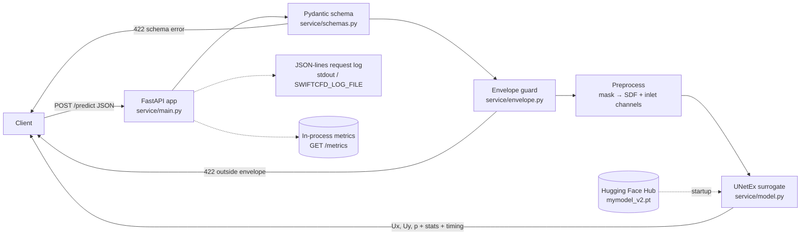

# 🌊 SwiftCFD — Neural Network Flow Field Predictor

[](https://huggingface.co/spaces/vamsigudipati/SwiftCFD)
[](https://huggingface.co/vamsigudipati/deepcfd-model)
[](LICENSE)

SwiftCFD is a deep learning surrogate model for Computational Fluid Dynamics (CFD).
It predicts steady-state laminar flow fields (Ux, Uy, pressure) around 2D obstacles
in **~50ms** — replacing hours of traditional CFD simulation.

---

## 🚀 Live Demo

👉 **[Try SwiftCFD on Hugging Face Spaces](https://huggingface.co/spaces/vamsigudipati/SwiftCFD)**

---

## 📦 Resources

| Resource | Link |
|---|---|
| 🤗 Model weights | [vamsigudipati/deepcfd-model](https://huggingface.co/vamsigudipati/deepcfd-model) |
| 🌊 Live Demo | [SwiftCFD Space](https://huggingface.co/spaces/vamsigudipati/SwiftCFD) |
| 📊 Dataset | [DeepCFD — Zenodo](https://zenodo.org/record/3666056) |
| 📄 Original Paper | [DeepCFD — arXiv](https://arxiv.org/abs/2004.08826) |

---

## 🏗️ Architecture

- **Model:** UNetEx (U-Net with skip connections + max unpooling)
- **Input:** 3-channel tensor `[SDF, Ux_inlet, Uy_inlet]` — shape `(3, 172, 79)`
- **Output:** 3-channel tensor `[Ux, Uy, p]` — shape `(3, 172, 79)`
- **Filters:** `[8, 16, 32, 32]` | **Kernel size:** `5×5`
- **Parameters:** ~500K | **Model size:** ~3.3MB

---

## 📊 Training

| | Pass 1 | Pass 2 (Fine-tune) |
|---|---|---|
| Script | `train_pass1.py` | `train_finetune.py` |
| Optimizer | Adam | AdamW (weight_decay=0.02) |
| Learning rate | 1e-3 | 1e-4 |
| Batch size | 64 | 64 |
| Scheduler | ReduceLROnPlateau (patience=20) | ReduceLROnPlateau (patience=50) |
| Early stopping | patience=100 | patience=200 |
| Max epochs | 2000 | 2000 |
| Best Val MSE | — | **0.739** |

---

## 📈 Results

| Field | R² | Slope |
|---|---|---|
| Ux | **0.9974** | 0.9977 |
| Uy | **0.9960** | 0.9983 |
| p  | **0.7552** | 0.7647 |

---

## 🛠️ Setup

### 1. Clone the repo
```bash
git clone https://github.com/vamsigudipati/SwiftCFD.git
cd SwiftCFD
```

### 2. Install dependencies
```bash
pip install -r requirements.txt
```

### 3. Download the dataset
```bash
wget https://zenodo.org/record/3666056/files/DeepCFD.zip
unzip DeepCFD.zip
# → dataX.pkl and dataY.pkl
```

---

## 🏋️ Training

### Pass 1 — Train from scratch
```bash
python train_pass1.py \
  --dataX dataX.pkl \
  --dataY dataY.pkl \
  --output checkpoint.pt
```

### Pass 2 — Fine-tune
```bash
python train_finetune.py \
  --checkpoint checkpoint.pt \
  --dataX dataX.pkl \
  --dataY dataY.pkl \
  --output mymodel_v2.pt
```

---

## 📊 Visualizations

```bash
# Plot sample predictions + scatter + training curves
python visualize.py \
  --checkpoint mymodel_v2.pt \
  --dataX dataX.pkl \
  --dataY dataY.pkl \
  --samples 103 487 354 563 520 \
  --out_dir ./assets

# Pass 1 vs Pass 2 comparison
python visualize.py \
  --checkpoint mymodel_v2.pt \
  --checkpoint1 checkpoint.pt \
  --dataX dataX.pkl \
  --dataY dataY.pkl \
  --plot comparison
```

---

## 🖥️ Run the App Locally

```bash
streamlit run app.py
```

The app has three tabs: pick a dataset sample, upload a `(3, 172, 79)` `.pkl`,
or draw your own obstacle (shape selector or freehand canvas). For an HTTP
API instead of a UI, see [Serving the model](#-serving-the-model).

---

## 🚀 Serving the model

Besides the Streamlit demo, the trained surrogate is packaged as a small
production-style **FastAPI inference service** in [`service/`](service/):
validated input schema, a training-envelope guard, structured request logs,
metrics, a CPU Docker image and a CI test suite.

### Architecture



| Endpoint | Purpose |
|---|---|
| `POST /predict` | Obstacle (primitive or 172×79 mask) + inlet velocity → `Ux`, `Uy`, `p` fields, per-field stats, `inference_time_ms`, `input_hash` |
| `GET /health` | Liveness/readiness: model loaded, version, uptime |
| `GET /model-info` | Model version, architecture, training-data summary, **input bounds** |
| `GET /metrics` | Request / prediction / rejection / error counts, p50 and p95 latency |
| `GET /docs` | Interactive OpenAPI UI |

Example request:

```bash
curl -s localhost:8000/predict -H 'content-type: application/json' -d '{
  "obstacle": {"type": "circle", "cx": 55, "cy": 39, "size": 10},
  "ux_inlet": 0.1,
  "include_fields": false
}'
```

`obstacle.type` is one of `rectangle`, `circle`, `diamond`, `triangle`
(rasterised server-side with the same rules as the app's Shape Selector) or
`mask` with an explicit `[172][79]` binary array (e.g. from a drawing tool).
`cx` runs along the streamwise axis (0–171), `cy` along the transverse axis
(0–78). Set `include_fields: false` to get statistics only.

### The envelope rule

The network was trained on 981 DeepCFD samples with **one obstacle in the
left-centre third of the domain** and a narrow inlet-velocity range. A neural
surrogate has no built-in sense of "I have not seen this": for an obstacle
placed elsewhere it quietly returns an averaged, physically meaningless field
that *looks* like a valid answer (this is exactly what sank the first version
of the Draw tab — see `DOCUMENTATION.md`, Issue 5).

The service therefore checks every request against the training envelope
and answers **`422 Unprocessable Entity`** with the violated bound instead of
returning a silent extrapolation:

```json
{
  "detail": {
    "reason": "outside_training_envelope",
    "message": "Input is outside the envelope the model was trained on, so the prediction would be a silent extrapolation. obstacle centre x 150 is outside the training envelope [30, 80]. See GET /model-info for the allowed bounds.",
    "violations": [{"field": "obstacle.cx", "value": 150, "allowed": {"min": 30, "max": 80}, "message": "..."}]
  }
}
```

The bounds live in one table in `service/envelope.py` and are exposed by
`GET /model-info` so clients can validate before calling. They are taken from
the "Known Limitations" above; if you retrain on a wider distribution, widen
them there.

| Quantity | Allowed |
|---|---|
| Obstacle centre x (streamwise, 0–171) | 30 – 80 |
| Obstacle centre y (transverse, 0–78) | 20 – 58 |
| Obstacle size (radius / half-width, cells) | 3 – 20 |
| Obstacle area fraction (mask input) | 0.2 % – 15 % |
| Number of obstacles | exactly 1 |
| `ux_inlet` (m/s) | 0.01 – 0.30 |
| `uy_inlet` (m/s) | 0 |

### Run locally

```bash
pip install --extra-index-url https://download.pytorch.org/whl/cpu -r service/requirements.txt
uvicorn service.main:app --host 0.0.0.0 --port 8000
```

Weights are downloaded from the Hub on first start. Environment variables:

| Variable | Default | Meaning |
|---|---|---|
| `SWIFTCFD_WEIGHTS` | `hf` | `hf` (download `mymodel_v2.pt`), a local `.pt` path, or `fixture` (seeded random weights for tests — **not a trained model**) |
| `SWIFTCFD_MODEL_VERSION` | file name | Version string reported by the API |
| `SWIFTCFD_LOG_FILE` | unset | Also append the JSON-lines request log to this file |
| `SWIFTCFD_LOG_LEVEL` | `INFO` | Log level |
| `SWIFTCFD_TORCH_THREADS` | `1` | CPU threads for inference |

Each `/predict` call writes one JSON line, e.g.

```json
{"ts":"2026-11-03T19:38:35.774Z","level":"INFO","logger":"swiftcfd.requests","event":"predict","input_hash":"8f3ccb3cad41b25b","latency_ms":78.3,"inference_ms":75.2,"in_envelope":true,"status":200,"outcome":"ok"}
```

### Run in Docker

```bash
docker build -t swiftcfd-service .
docker run --rm -p 8000:8000 -v swiftcfd-hf:/cache/hf swiftcfd-service
```

or with Compose (persists the Hub cache and writes `logs/requests.jsonl`):

```bash
docker compose up --build
```

The image is CPU-only on `python:3.12-slim`, runs as a non-root user and has
a `/health` healthcheck. Mount local weights and set
`SWIFTCFD_WEIGHTS=/weights/mymodel_v2.pt` to run fully offline.

### Tests and CI

```bash
pip install pytest httpx
pytest
```

The suite (`tests/`) covers schema validation, envelope rejection, health and
metrics, JSON-lines logging, and a prediction smoke test against a stored
reference output (`tests/fixtures/reference_prediction.json`). It runs on
deterministic fixture weights so CI needs no network; regenerate the
reference for the real weights with
`SWIFTCFD_WEIGHTS=/path/mymodel_v2.pt python tests/make_reference.py`.
`.github/workflows/tests.yml` runs the tests and builds the image on every
push.

---

## 📁 Repository Structure

```
SwiftCFD/
├── app.py                  ← Streamlit demo app
├── service/                ← FastAPI inference service (see "Serving the model")
│   ├── main.py             ← endpoints: /predict /health /model-info /metrics
│   ├── schemas.py          ← Pydantic request / response models
│   ├── envelope.py         ← training-envelope guard (422 outside bounds)
│   ├── preprocess.py       ← mask → SDF + inlet channels
│   ├── model.py            ← UNetEx + weight loading (HF / local / fixture)
│   ├── metrics.py          ← request counts, p50/p95 latency
│   └── logging_utils.py    ← JSON-lines request log
├── tests/                  ← pytest suite for the service
├── Dockerfile              ← CPU-only image for the service
├── docker-compose.yml
├── .github/workflows/      ← CI: tests + docker build; docs PDF export
├── train_pass1.py          ← Pass 1: train from scratch
├── train_finetune.py       ← Pass 2: fine-tuning
├── visualize.py            ← Visualization scripts
├── requirements.txt        ← Python dependencies
├── README.md               ← This file
├── DOCUMENTATION.md        ← Full project documentation
├── LICENSE                 ← MIT License
├── .gitignore
└── assets/                 ← Result plots and snapshots
    ├── pass1_sample0.png
    ├── pass1_sample1.png
    ├── pass1_sample2.png
    ├── training_curves_v2.png
    ├── finetune_sample103.png
    ├── finetune_sample487.png
    ├── finetune_sample354.png
    ├── finetune_sample563.png
    ├── finetune_sample520.png
    └── scatter.png
```

> **Note:** Model weights (`*.pt`) and dataset (`*.pkl`) are NOT stored
> in this repository. They are hosted on
> [Hugging Face](https://huggingface.co/vamsigudipati/deepcfd-model)
> and downloaded automatically at runtime.

---

## ⚠️ Known Limitations

- Best results when obstacle is placed in the **left-center third** of the
  domain (x = 30–80), matching the training data distribution
- Fixed input resolution of `172 × 79` cells
- Laminar flow only (low Reynolds number)
- 2D predictions only

See [DOCUMENTATION.md](DOCUMENTATION.md) for full details.

---

## 🙏 Acknowledgements

Based on [DeepCFD](https://github.com/mdribeiro/DeepCFD) by Ribeiro et al.

```bibtex
@article{deepcfd2020,
  title   = {DeepCFD: Efficient Steady-State Laminar Flow Approximation
             with Deep Convolutional Neural Networks},
  author  = {Ribeiro, Mateus D. and Rehman, Auwal and Ahmed, Shahood
             and Dengel, Andreas},
  journal = {arXiv preprint arXiv:2004.08826},
  year    = {2020}
}
```